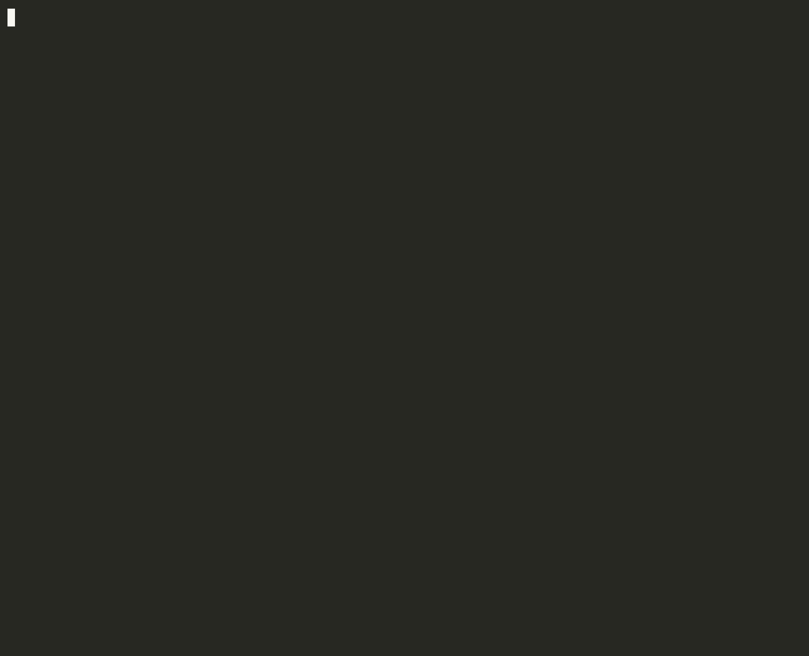

# Second Opinion

[](https://github.com/pyaroslav/second-opinion/actions/workflows/tests.yml)
[](https://youtu.be/NHd2CHh6tTs)
[](https://huggingface.co/pyaroslav/second-opinion-qwen3-8b-lora)
[](LICENSE)



Second Opinion gives a first-pass review of an Oracle AWR or Statspack report. It runs on your own machine with a local open model, Gemma 4 via Ollama, so the report never leaves the box.

This is a real run on one of the held-out lab reports (`reports/test/hard_parse-statspack-*`):

```
$ second-opinion statspack.txt
# Second Opinion: statspack.txt

Statspack report · ORCLCDB 12.2.0.1.0 · 13-Oct-26 16:58:47 to 13-Oct-26 17:05:47 (7.0 min, DB time 27.71 min)

**High Hard Parse Rate Indicates Inefficient SQL Usage**

Likely causes, most important first: Hard parsing (literal SQL, no binds)

## Note for the client

The Statspack report indicates a significant performance issue related to SQL execution. The primary
finding is a high rate of hard parses, with 100.0% of parses being hard parses. This is evidenced by
the high hard_parses_per_sec of 8811.8 and the associated wait event library cache: mutex X
consuming 39.5% of DB time. To address this, first, review the application code to ensure all SQL
statements utilize bind variables instead of literals. Second, investigate the SQL statements
causing these parses to identify opportunities for better indexing or query rewriting.

## Findings (computed from the report, not by the model)

- **Hard parsing (literal SQL, no binds)** (score 1.0): Most parses are hard parses: SQL is being
  sent with literals instead of bind variables.
  `hard_parses_per_sec=8811.8, parses_per_sec=8812.8, hard_parse_pct=100.0,
   shared_pool_event=library cache: mutex X, shared_pool_event_pct_db_time=39.5`

_Numbers checked: 3; every number in the note was found in the report. Model: gemma4:e4b. 0.5 s, all local._
```

The diagnosis is right, and so are the numbers. The second suggestion in the note (indexing, query rewriting) doesn't address this problem. This is why the output is a draft for a DBA to edit, not something to send unread.

## Who it is for

- **Freelance and contract DBAs.** They review AWR reports for clients, usually under NDA, and often bill by the hour. Pasting a client's report into a hosted chatbot puts SQL text, schema names and hostnames on someone else's server. Second Opinion runs locally and produces a ranked first pass and a draft client note in seconds. The DBA still makes the call.
- **Standard Edition shops.** Standard Edition and SE2 can't license the Diagnostics Pack, so they have no AWR and no ADDM. They have Statspack and often nobody to read it. Second Opinion treats Statspack as a first-class input.

## How it works

1. **Parse.** `second_opinion/awr.py` reads AWR HTML, and `second_opinion/statspack.py` reads 12.2-style Statspack text. `second_opinion/text.py` reads everything else: AWR text, Statspack from older releases, and partial pastes, token by token, because pasted whitespace is often mangled. On all 32 lab runs it gives exactly the same findings as the HTML and Statspack parsers (`tests/test_core.py`). Both produce the same small dict: load profile, top timed events, time model, instance activity, top SQL by elapsed time, CPU, gets, reads and executions, plus segment statistics. A raw AWR report is roughly 18k tokens, more than a small local model handles well. The dict is a fraction of that.
2. **Rules.** `second_opinion/rules.py` scores the causes a DBA checks first:
   - hard parsing
   - full scans or a missing index
   - row lock contention
   - committing too often
   - NOCACHE/ORDER sequences
   - one CPU-heavy statement
   - Resource Manager CPU caps

   A materiality gate (0.5 average active sessions) stops a large percentage of an idle database from becoming a finding.
3. **Gemma 4.** `second_opinion/review.py` gives the model the parsed report and the findings. It asks for a ranked diagnosis and a short note a DBA could send to a client. Findings that score below the significance threshold are labelled "not significant", so the model doesn't promote them.
4. **Number check.** Every number in the model's answer is checked against the numbers it was given. Rounding and thousands separators are allowed; anything else is unsupported. If the check fails, the model gets one retry. If it fails again, the review prints the unsupported numbers in a warning instead of hiding them.

The rules and the number check do not depend on the model. `--no-gemma` prints the findings alone.

## Install and run

```
pip install -e .                 # Python 3.10+
ollama pull gemma4:e4b
second-opinion awrrpt_10_11.html                 # AWR, HTML as awrrpt.sql writes it
second-opinion sp_10_11.lst                      # Statspack, text as spreport.sql writes it (any release)
second-opinion awrrpt_10_11.txt                  # AWR text
second-opinion pasted.txt                        # just the sections someone pasted (Load Profile, Top events, ...)
second-opinion report.html --out review.md       # also save the review
second-opinion report.html --json                # machine-readable
second-opinion report.html --no-gemma            # rules only, no model
second-opinion report.html --model gemma4:26b    # a bigger local model
second-opinion report.html --triage-model second-opinion-qwen3   # also the fine-tuned model's own ranking (see below)
```

## Results

Every result comes from a fault lab: two disposable Oracle databases in Docker on one workstation. `lab/faults.py` runs a workload with one known fault, or two at once. It takes a snapshot before and after the window, then saves the reports a DBA would get. `lab/score.py` checks whether each reviewer named the fault that was injected.

| Database | What it produces |
|---|---|
| Oracle AI Database 26ai Free 23.26.3 | AWR + ADDM |
| Oracle Database 12.2.0.1 Standard Edition 2 (`control_management_pack_access=NONE`) | Statspack level 7 only |

The four reviewers all see the same window:

| Reviewer | What it is |
|---|---|
| ADDM | Oracle's own advisor on the same snapshots. Its finding titles are mapped to a cause (see `ADDM_TITLES` in `lab/score.py`). |
| Raw Gemma | Gemma 4 e4b given the raw report text, as much as fits, with the same prompt format and causes as ours. |
| Rules | Our rules alone, ranked by score. |
| Second Opinion | The rules plus Gemma 4 e4b. This is the tool. |

**Pass criteria:**
- One injected cause: the cause must be in the reviewer's top two.
- Two injected causes: both must be in the top three.
- Healthy runs: the reviewer must say healthy, or ADDM must report no findings.

### Held-out test set (the headline)

There were 18 runs: 9 AWR and 9 Statspack, each 7 minutes long. They used the same causes as the dev set but different SQL, tables and session counts, plus two runs with two faults at once. The rules were written while looking only at the dev runs. The test runs were generated afterwards, and the rules were scored on them once.

| Reviewer | AWR (9) | Statspack (9) |
|---|---|---|
| ADDM | 7/9 | not available on SE2 |
| Gemma 4, raw report | 5/9 | 5/9 |
| Rules alone | 9/9 | 8/9 |
| **Second Opinion** | **9/9** | **8/9** |

Numbers in the model's answers that were not in the data it was given: **0** for both Gemma reviewers. Second Opinion never needed its retry. A Second Opinion review takes 0.7 s (median) on a local GPU, against 2.3 s for Gemma reading the raw report. An earlier run measured about 5 s for both, because the two reviewers used different context sizes and Ollama reloaded the model on every switch. Sentry tracing showed the gap; see the post.

Per-run rankings are in `results/test-gemma4_e4b.json`. The reports themselves are in `reports/test/`.

What the misses were:
- **ADDM, full scan, and full scan + commit storm.** ADDM's finding is "Top SQL Statements" for the right query. Its advice is "Run SQL Tuning Advisor", which needs the Tuning Pack. It never says the query full-scans a 400k-row table that has no index on the column in its `where` clause.
- **Raw Gemma.** It misses all four full-scan runs (single and combined, on both databases) and both NOCACHE sequence runs. It reads both healthy runs as row lock problems. Given the whole report, it is drawn to whatever wait event looks alarming.
- **Second Opinion, Statspack NOCACHE sequence.** The 12.2 Statspack report for that window shows commit pressure but no sequence-specific wait in its top events. So the rules rank only `commit_storm`, and the review follows them. The rules were left as they are rather than tuned on the test set.

The first ADDM scoring used keyword matching, which mislabelled two correct ADDM findings ("Hard Parse" and "Sequence Usage") because the surrounding text mentioned CPU. That scoring gave ADDM 5/9. The ADDM findings for every run were then checked by hand, and the scorer was changed to map ADDM's finding titles. 7/9 is the corrected figure.

### Dev set

There were 14 runs: 7 AWR and 7 Statspack, each 5 minutes long. The rules were developed on these runs, so treat their scores as a training score, not a result.

| Reviewer | AWR (7) | Statspack (7) |
|---|---|---|
| ADDM | 6/7 | not available on SE2 |
| Gemma 4, raw report | 4/7 | 4/7 |
| Rules alone | 7/7 | 7/7 |
| Second Opinion | 7/7 | 7/7 |

On the dev set, raw Gemma stated one number that wasn't in its input; Second Opinion stated none.

### Public reports (worked examples, not a test)

I collected ten AWR and Statspack reports posted publicly on the OraFAQ forums and Jonathan Lewis's blog, each with an expert's diagnosis in the thread. All ten are text (Oracle 9i–11g), and many are a few pasted sections. They exposed two gaps:
- Full scans from disk (`db file scattered read` / `direct path read`) never occur in the lab, where the tables fit in the buffer cache, so the rules didn't check for them.
- A dominant wait that no check explains was reported as "healthy".

Both checks were added *after* reading these cases. With them, the rules match the expert on 7 of 10. The three misses are two excerpts without the SQL sections the diagnosis needs, and a log-switch problem below the threshold. Because the checks were written with these cases in view, they're worked examples, not an accuracy figure. The reports aren't redistributed here; the thread links are in the post.

### Fine-tuned Qwen3-8B on Tinker (an experiment, not the CLI)

Can a small open model learn the triage from the parsed numbers alone, with no rules? `lab/tune/` fine-tunes Qwen3-8B with LoRA (rank 32) on [Tinker](https://thinkingmachines.ai/tinker/). The training data is 524 generated lab runs with their own tables and SQL. The 472 runs where the injected fault reached the report give 425 for training and 61 for validation (47 generated plus the 14 dev runs). The task is to output a ranked JSON list of causes. The prompt is the same for the base and the tuned model, with thinking off. I picked the epoch on validation, then scored once on the 18 held-out runs:

| Qwen3-8B, held-out (18) | AWR | Statspack | Top cause right | False causes |
|---|---|---|---|---|
| Base, untuned | 5/9 | 6/9 | 11/18 | 38 |
| Tuned (epoch 3 of 3) | 8/9 | 8/9 | 18/18 | 0 |

Pass is the same rule as above. A false cause is a label that wasn't injected; `cpu_cap` isn't counted, since Free really does throttle itself. Both tuned misses are the full-scan + commit-storm pair, where it drops the full scan. Training cost about $1.61 at list price (3.66M tokens), and about $2 including the early run and evaluation. Results: `results/tune-*.json`.

To run it offline, `lab/tune/export.py` merges the adapter into the `qwen3:8b` weights Ollama already has and quantizes to Q8_0. The local copy passes 16/18 and agrees with Tinker's top cause on 17/18, at about 0.5–0.7 s per report. The adapter (PEFT and GGUF) is at [pyaroslav/second-opinion-qwen3-8b-lora](https://huggingface.co/pyaroslav/second-opinion-qwen3-8b-lora). The rules + Gemma review stays the default. With `--triage-model second-opinion-qwen3`, the CLI also asks the tuned model for its own ranking, using the exact prompt it was trained on (`second_opinion/triage.py`). It checks the numbers in the model's evidence against the report, and says whether the model agrees with the review. On the held-out set, this local second read gets the one report the review misses (the NOCACHE sequence on 12.2 Statspack) and disagrees on the healthy AWR run with real deadlocks, so a disagreement is a reason to read both, not a verdict.

## Limits

These are lab faults, one or two at a time, on a 26ai Free instance and a 12.2 SE2 container. Real systems are messier: several overlapping problems, RAC, Exadata, real storage, and reports covering an hour, not seven minutes. The set of causes is small and fixed. Anything outside it is reported as "other" at best.

- **Resource Manager CPU caps on Free.** 26ai Free limits its own CPU use through Resource Manager. Busy workloads show `resmgr:cpu quantum`, and both ADDM and the rules rank `cpu_cap` alongside the injected cause. That's correct for this database, but it's an artefact of Free.
- **Deadlocks in the held-out healthy AWR run.** The light update workload on `counters` hit two genuine ORA-00060 deadlocks, which ended two of its three sessions early. Second Opinion still called the window healthy. The rules list `row_lock` second, below the significance threshold.
- **ADDM on short windows.** On very short windows (18 s and 90 s, in early probing), ADDM reported nothing at all. On 5- and 7-minute windows it found most faults. All the scored runs are 5 minutes or longer.
- **A first pass, not a verdict.** Read the findings before you send anything.

## Running the lab yourself

The lab needs Docker and an Oracle Free image. Statspack needs an SE2 or EE image, with Statspack installed (`spcreate.sql`) and the perfstat user's password set to match `lab/faults.py`. The lab passwords in `lab/faults.py` are for throwaway local containers bound to 127.0.0.1.

```
pip install -e '.[lab,dev]'
python lab/faults.py all --seconds 300                  # dev set, AWR
python lab/faults.py all --seconds 300 --target se2     # dev set, Statspack
python lab/faults.py all --test --seconds 420           # held-out set
python lab/score.py --runs reports/test                 # score once
python lab/score.py --runs reports/test --addm-only     # re-map ADDM without model calls
pytest
```

Fine-tuning (needs `TINKER_API_KEY` and `pip install tinker tinker-cookbook`):

```
python lab/tune/generate.py --target free --runs 200      # training runs, own tables and SQL
python lab/tune/build.py                                  # data/tune/{train,val,test}.jsonl
python lab/tune/train.py --dry-run --epochs 3             # tokens and estimated cost
python lab/tune/train.py --epochs 3 --name so             # a sampler checkpoint per epoch
python lab/tune/evaluate.py --set val --model base --model tinker://.../so-ep2
tinker checkpoint download tinker://.../sampler_weights/so-ep2 --output models/
python lab/tune/export.py models/<dir> --name second-opinion-qwen3
python lab/tune/baseline_local.py --model second-opinion-qwen3 --runs reports/test --compare results/tune-test-so-ep2.json
```

In the lab, the 12.2 Statspack report failed with a divide-by-zero error. Its header computes cursors per session by dividing by the session count, and for these PDB-level snapshots that count was zero. So the lab runs a copy of `sprepins.sql` that wraps the two divisors in `nullif(...,0)`. Reports from ordinary databases don't need this.

## Tracing (optional)

Sentry tracing is off unless `SENTRY_DSN` is set (`pip install -e '.[tracing]'`). Each review is then one agent transaction with spans for parsing, the rules and each model call, including the retry. What leaves the machine:
- span names and durations
- the model name
- token counts
- which causes the rules found
- how many numbers failed the check, and whether the model retried

No prompts, no model answers, no report contents, no SQL text, no hostnames and no PII (`send_default_pii=False`). See `second_opinion/tracing.py`.

## License

MIT
